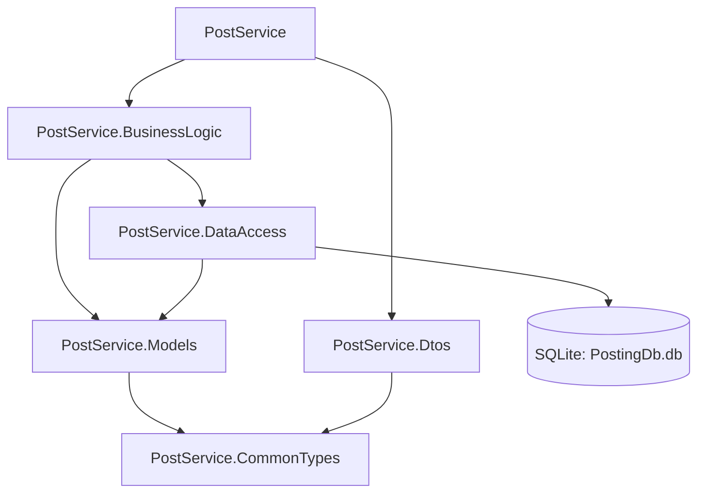

# ПР-41. Робота з базою даних

PostService зберігає поштові відправлення у **SQLite** через ADO.NET (`Microsoft.Data.Sqlite`). Статичну колекцію замінено репозиторієм. Дані та видалення зберігаються після перезапуску API.

## Структура

Рішення `PostServiceSolution/PostService.slnx` містить шість проєктів:

| Проєкт | Призначення |
|---|---|
| PostService.CommonTypes | DeliveryType |
| PostService.Models | Модель Posting |
| PostService.Dtos | Контракти POST, PUT, GET |
| PostService.DataAccess | IPostingRepository, PostingRepository, SQL і CreateDb |
| PostService.BusinessLogic | Перевірка даних, тарифи й операції через IPostingRepository |
| PostService | HTTP, DI, мапер, запуск міграції |



## Запуск

Потрібен .NET SDK 10. З кореня репозиторію:

```powershell
cd PostServiceSolution
dotnet build PostService.slnx -warnaserror
dotnet run --project PostService/PostService.csproj
```

За замовчуванням API доступне на `http://localhost:5050`. Файл `PostingDb.db` створюється автоматично в ContentRoot веб-застосунку: при наведеному запуску — у `PostServiceSolution/PostService`. Базу та її службові файли виключено з Git; після клонування вони створяться при першому запуску. Встановлювати сервер SQLite окремо не потрібно.

Для іншого порту:

```powershell
dotnet run --project PostService/PostService.csproj -- --urls http://localhost:5051
```

## Запити

У VS Code відкрити папку `PostServiceSolution` та файл `requests.http`. Виконати запити **Send Request** послідовно. Альтернативно користуватися будь-яким HTTP-клієнтом.

| Метод | Шлях | Очікувана відповідь |
|---|---|---|
| GET | `/postings` | 200, список із SQLite |
| GET | `/postings/{id}` | 200 або 404 |
| POST | `/postings` | 201 та Location, або 400 |
| PUT | `/postings/{id}` | 200, 400 або 404 |
| DELETE | `/postings/{id}` | 204, або 404 |

Приклад тіла POST:

```json
{
  "from": "Київ",
  "to": "Львів",
  "content": "Книги",
  "deliveryType": "Department",
  "weight": 2,
  "width": 20.5,
  "height": 15.25,
  "depth": 2.5,
  "value": null,
  "description": "Не згинати"
}
```

Id створює SQLite; Price та CreatedAt визначає сервіс. Value і Description необов’язкові; розміри підтримують дробові значення відповідно до REAL у схемі завдання. CreatedAt зберігається як UTC Unix seconds (INTEGER), тому точність — до секунди. PUT приймає додатково `id` і `price`, зберігаючи дату створення. Тарифи залишені з попередніх робіт як навчальне припущення: `40 + 10 × вага`, `80 + 15 × вага`, `120 + 24 × вага`.

## Перевірка

Команди з кореня репозиторію:

```powershell
dotnet run --project Checks/DatabaseChecks.csproj
dotnet run --project Checks/DatabaseChecks.csproj -- --api-dll PostServiceSolution/PostService/bin/Debug/net10.0/PostService.dll
```

Перша команда виконує 11 перевірок репозиторію й сервісу. Друга — **19 перевірок**, включно з реальним API та його двома перезапусками. Вона сама запускає й зупиняє дочірній API на вільному локальному порту, використовує окрему тимчасову базу та прибирає свої дані. Основна база користувача не змінюється.

Результат: **19/19**, складання — **0 помилок, 0 попереджень**. Фактичний [вивід перевірок](reports/checks-output.txt), [збірки](reports/build-results.txt), [звіт і дев’ять відповідей на контрольні запитання](reports/REPORT.md).

`CreateDb` реалізує початкову ідемпотентну міграцію `CREATE TABLE IF NOT EXISTS`; він не оновлює структуру вже наявної таблиці іншої версії. Це окрема практична з новим файлом бази.
